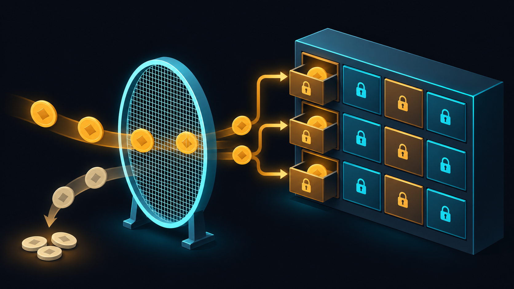
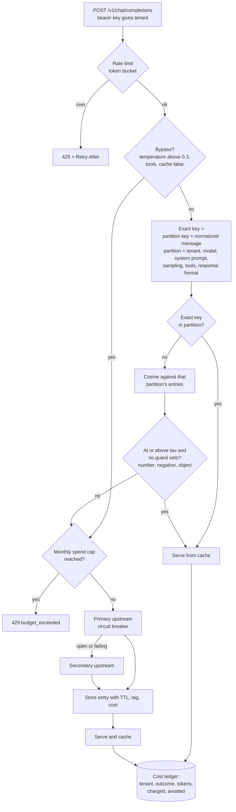

# falsehit

[](https://github.com/SlateGitOrg/falsehit/actions/workflows/ci.yml)



falsehit is a FastAPI gateway that puts a semantic cache in front of an OpenAI-compatible chat endpoint. The cosine threshold that decides "close enough" is not picked by eye: it is the smallest value whose one-sided 95% Clopper-Pearson upper bound on the false-hit rate, measured on labelled near-miss pairs with the guards applied, is at or below a target. The bound holds for near-miss pairs drawn like the calibration set, given those guards; it is a measured property of that distribution, not a guarantee for arbitrary traffic. Cache keys are partitioned by tenant, model, system prompt and sampling parameters, rule-based guards veto matches that differ in a number, a negation or a plan or object, and a Decimal ledger books savings only for hits that served the right answer. All data in the repository is synthetic and the default run is fully offline.

## The problem

A help-desk vendor puts a semantic cache in front of its support assistant to cut model spend. With a loose similarity threshold, "how do I cancel one seat" is answered with the cached answer for "how do I cancel my subscription", and a question about 2024 invoices gets the 2025 answer. The user receives a confident wrong answer, and the hit-rate dashboard books it as a saving. Cache keys that ignore the tenant or the system prompt also leak answers between customers.

Hashed or embedded text similarity cannot separate these pairs: they differ in one token out of a handful. So the gateway does three things. It fits the threshold from a statistical bound on near-miss pairs, so the false-hit rate is a number with a confidence level. It adds guards that look at exactly the tokens similarity ignores. And it measures savings net of false hits.

## How it works



`POST /v1/chat/completions` is OpenAI-compatible and non-streaming. `GET /v1/cache/stats` returns the calling tenant's counters and daily rollups. `POST /v1/cache/invalidate` drops the caller's entries, optionally only those with a given `cache_tag`. Every response carries `x-cache: hit|miss|bypass`; misses that a guard rejected also carry `x-cache-veto`.

| Module | Role |
| --- | --- |
| `keys.py` | canonical-JSON partition key, exact key, bypass rules |
| `embed.py` | offline hashing embedding: word unigrams and bigrams plus character 3-5-grams into 2^15 signed buckets, sublinear tf, l2 norm |
| `guards.py` | `number_mismatch`, `negation_mismatch`, `object_mismatch` vetoes |
| `store.py` | per-partition index, brute-force cosine, TTL, tags, JSONL snapshot |
| `calibrate.py` | Clopper-Pearson threshold fit, held-out check, guard ablation |
| `resilience.py`, `limits.py` | circuit breaker with failover, token bucket, spend cap |
| `ledger.py` | append-only Decimal ledger, price table, daily rollups |
| `replay.py` | drives the app in-process with labelled traffic and scores it |

## Quick start

```bash
uv venv .venv
uv pip install --python .venv/bin/python -e ".[dev]"

.venv/bin/falsehit seed                           # pairs, traffic and tenants into data/
.venv/bin/falsehit calibrate --target-fhr 0.01    # fits tau, writes data/calibration.json
.venv/bin/falsehit replay data/traffic.jsonl      # 5,000 requests through the app, no network
.venv/bin/python -m pytest -q

# run the service (offline fake upstream unless FALSEHIT_UPSTREAM_BASE_URL is set)
.venv/bin/falsehit serve --config falsehit.example.yaml
curl -si localhost:8000/v1/chat/completions \
  -H 'Authorization: Bearer change-me-acme' -H 'Content-Type: application/json' \
  -d '{"model":"support-large","messages":[{"role":"user","content":"How do I export invoices for 2025?"}]}'
```

A real upstream is an OpenAI-compatible endpoint configured by `FALSEHIT_UPSTREAM_BASE_URL`, `FALSEHIT_UPSTREAM_API_KEY` and `FALSEHIT_UPSTREAM_MODEL`; an optional secondary uses the same names with `FALSEHIT_SECONDARY_` in place of `FALSEHIT_UPSTREAM_`. A container image is built with `docker build -t falsehit .`.

## Example output

All numbers below come from `falsehit calibrate --target-fhr 0.01` and `falsehit replay data/traffic.jsonl` on the seeded data (seed 7). The pairs are split by family, so the held-out pairs involve intents, intent pairs and templates that the threshold was never fitted on. The calibration table lists every fifth candidate threshold plus the chosen one. "With guards" applies the three vetoes after the cosine test; "without guards" is cosine alone. FHR is accepted near-miss pairs over near-miss pairs on the 750-pair calibration split, the bound is the one-sided 95% Clopper-Pearson upper bound, and recall is the share of the 750 calibration paraphrase pairs that are accepted.

```text
  tau |     FHR  CP bound  recall |     FHR  CP bound  recall
      |        with guards        |      without guards      
 0.30 |  0.0267    0.0385   0.915 |  0.7467    0.7727   0.915
 0.35 |  0.0187    0.0290   0.851 |  0.6760    0.7042   0.851
 0.40 |  0.0147    0.0242   0.803 |  0.5853    0.6153   0.803
 0.45 |  0.0080    0.0157   0.748 |  0.5253    0.5559   0.748
 0.50 |  0.0067    0.0140   0.689 |  0.4907    0.5213   0.689
 0.55 |  0.0053    0.0122   0.639 |  0.4440    0.4746   0.639
 0.60 |  0.0027    0.0084   0.603 |  0.4147    0.4451   0.603  <- chosen
 0.65 |  0.0000    0.0040   0.565 |  0.3560    0.3858   0.565
 0.70 |  0.0000    0.0040   0.523 |  0.3160    0.3451   0.523
 0.75 |  0.0000    0.0040   0.481 |  0.2653    0.2932   0.481
 0.80 |  0.0000    0.0040   0.449 |  0.2227    0.2491   0.449
 0.85 |  0.0000    0.0040   0.427 |  0.1520    0.1752   0.427
 0.90 |  0.0000    0.0040   0.408 |  0.0240    0.0354   0.408
 0.95 |  0.0000    0.0040   0.405 |  0.0000    0.0040   0.405
 1.00 |  0.0000    0.0040   0.345 |  0.0000    0.0040   0.345

target false-hit rate 0.01, one-sided 95% Clopper-Pearson bound
chosen tau 0.60: calibration 2/750 accepted near-misses, bound 0.0084
held-out at tau 0.60: false-hit rate 0.0000 with guards (0/750), 0.4187 without (314/750)
held-out paraphrase recall: 0.712 with guards at tau 0.60
  without guards tau must be refitted to 0.92, where recall is 0.451

guard ablation on held-out near-misses at the chosen tau:
subset     pairs  no guards  own guard  all guards
number       300        197          0           0
negation     225         98          0           0
object       225         19          0           0
```

Without guards the same bound needs tau 0.92, and held-out recall falls from 0.712 to 0.451. At tau 0.60 cosine alone would accept 197 of 300 number near-misses, 98 of 225 negation near-misses and 19 of 225 object near-misses on the held-out split; the guards bring all three to zero. The held-out object subset contains a family the default vocabulary does not cover (export objects), and cosine at 0.60 still rejects those pairs, which is the threshold doing its job on unseen pairs.

Replay of the 5,000 labelled requests (3 tenants, Zipf 1.1 intent popularity, 10% at temperature 0.8, entries live 2 hours):

```text
tau 0.60, ttl 7200s
tenant       requests  hit rate false hits  spend (USD)  savings (USD)
----------------------------------------------------------------------
brightdesk       2237     0.486          0       1.4094         1.3001
cobaltly         1661     0.467          0       1.0871         0.9290
pinecrest        1102     0.423          0       0.7701         0.5478
all              5000     0.466          0       3.2666         2.7768
```

There are no cross-tenant hits, all 500 temperature-0.8 requests bypass the cache, and none of the 2,328 hits served the wrong intent. Savings are the avoided cost of those hits; any false hit would have been subtracted. Lowering the threshold shows what the bound does not cover: `falsehit replay data/traffic.jsonl --tau 0.54` serves the "invite a guest" answer to a coworker question, a pair from a family the default guard vocabulary omits, so only the threshold separates it. The bound is on a sample of near-misses, not on all of them.

## Design decisions

**Guards sit beside the threshold, and veto in both directions.** A signature (set of numbers, set of negation and antonym poles, set of plan and object terms) is computed per message, and any difference vetoes the match. A query that mentions an extra number or plan term therefore misses the cache. That costs one upstream call; a false hit costs a wrong answer. The price is lower recall on messages that add incidental terms, which is why the synthetic paraphrases share their intent's key terms, as real support queries tend to.

**Calibration fits tau with the guards on, so the bound is conditional on them, and the vocabulary is deliberately incomplete.** The default object vocabulary lists plans, subscriptions, seats, workspaces, accounts, passwords and API keys, but not invitation targets or export objects. Those two families give each split object near-misses that only the threshold can stop, so tau is not trivially the bottom of the scan. Changing the vocabulary changes the fitted tau, so recalibrate after editing it. Real deployments should extend the vocabulary (`Settings.vocabulary`) from their own confusion data.

**The bound covers near-misses, not unrelated questions.** The labelled pairs only contain paraphrases and near-misses, so the false-hit bound says nothing about a cosine of 0.60 between two unrelated questions. The scan starts at 0.30 and the replay is the check on unrelated traffic: it scores every served answer against the true intent, and its false-hit share of hits (0 of 2,328) is reported next to the bound rather than assumed.

**Exact brute-force cosine over sparse arrays.** A dense 2^15 float32 row is 128 KB, so a few thousand entries per partition would cost hundreds of megabytes. Entries are stored as CSR-style numpy arrays and scored with one gather and one segmented sum, which is exact and fast enough for partitions of a few thousand entries. Past that, an approximate index would be the next step; the interface (`candidates`) would not change. Hashing also means two different words can collide in a bucket, which is why the guards read the text, not the vector.

**Savings are net of false hits, and the ledger is append-only.** On a hit the avoided cost is the stored cost of the original call. The ledger keeps charged and avoided amounts per request in `Decimal`, with daily rollups derived from the same records. The gateway cannot know whether a hit was right, so replay (which knows the true intent) subtracts false hits from the gross avoided cost. A hit-rate dashboard alone would have counted it.

**Key, TTL and upstream-error choices.** The partition key hashes tenant, model, system prompt, temperature, top-p, max_tokens, tools and response format; a request that omits temperature is pinned to 0 so it can be cached. Requests with assistant or tool turns, or with more than one user message, bypass the cache because the answer then depends on history the key does not cover. Only 5xx, 429 and transport errors count against the circuit breaker; other 4xx responses from the upstream are returned to the caller (a 401 or 403 becomes a 502, since it is the gateway's own credential) and leave the breaker alone. Entries expire a fixed time after creation and a hit does not extend them, so a stale answer cannot be kept alive by popularity.

## Testing

```bash
.venv/bin/python -m pytest -q          # offline; the live-upstream test is skipped
FALSEHIT_LIVE=1 FALSEHIT_UPSTREAM_BASE_URL=... .venv/bin/python -m pytest -q -m live
```

The suite checks canonical keys against key order and whitespace; the Clopper-Pearson bounds (0.01543 for 3/500, 0.00994 for 0/300); the family-disjoint split of the labelled pairs; the calibration acceptance criteria on the seeded pairs (bound at most 0.01, held-out false-hit rate at most 0.015, held-out recall at least 0.5 and higher with guards than without); the guard ablation; the 2024-after-2025 veto at a cosine above the threshold; TTL and tag invalidation under an injected clock; the circuit breaker schedule (primary failing calls 1-3, call 4 skipped, one probe after 30 seconds) and that client errors do not trip it; max_tokens and repeated user turns in the key; the 61st request getting 429 with `Retry-After` and a spend cap that blocks misses but serves hits; the OpenAI response schema; and the full replay (no cross-tenant hits, every hot request bypassed, hit rate in [0.35, 0.65], false-hit share at most 0.02, ledger totals equal to the sum of records, false hits excluded from savings).

## Project layout

```text
src/falsehit/
  api.py          FastAPI app factory and endpoints
  gateway.py      request flow: limits, bypass, lookup, guards, upstream, ledger
  keys.py         partition and exact keys, bypass rules
  embed.py        hashing embedding
  guards.py       number, negation and object vetoes
  store.py        per-partition semantic index
  calibrate.py    threshold fit, held-out check, ablation
  upstream.py     ChatModel protocol, FakeUpstream, OpenAICompatUpstream
  resilience.py   circuit breaker and failover
  limits.py       token bucket and spend cap
  ledger.py       Decimal ledger and price table (prices.yaml)
  intents.py      synthetic help-desk catalogue and keyword table
  seed.py         pairs, traffic and tenants generator
  replay.py       in-process traffic replay
  cli.py          seed, calibrate, replay, serve
tests/            pytest suite
Dockerfile        service image
falsehit.example.yaml
```

## License

MIT. See `LICENSE`.
